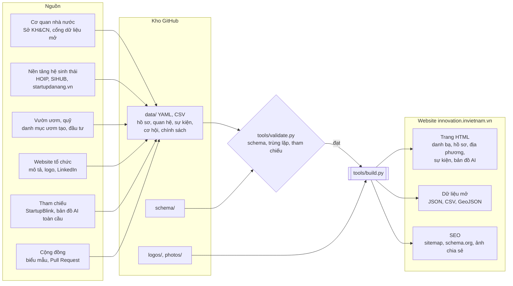
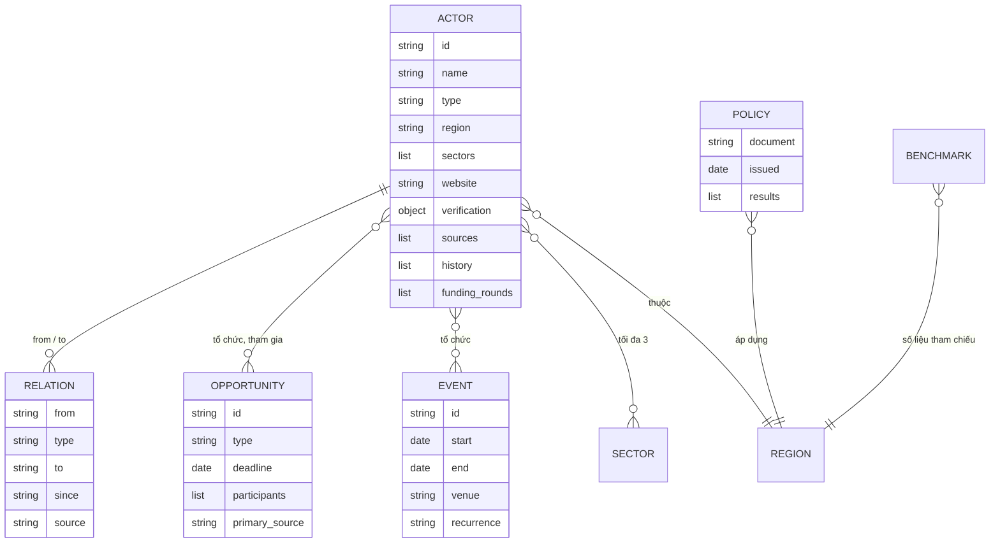
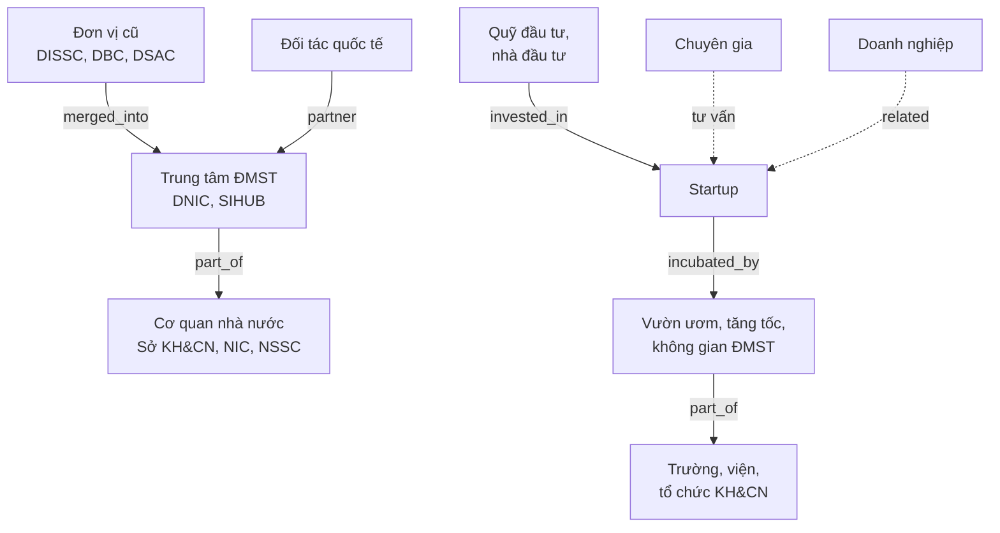
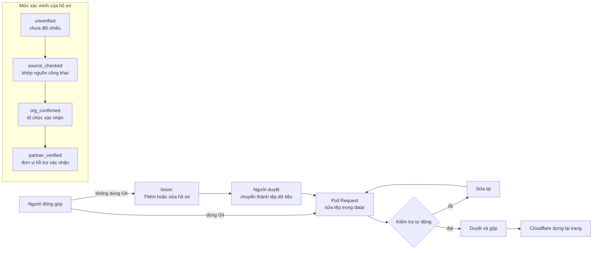
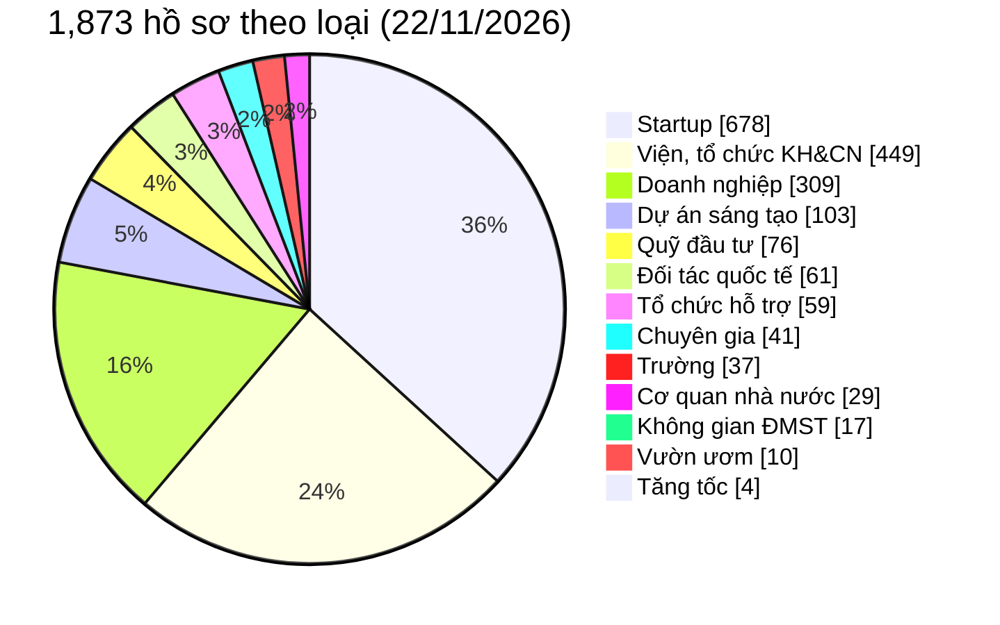

# Bản đồ hệ sinh thái khởi nghiệp đổi mới sáng tạo Việt Nam

*Vietnam Startup & Innovation Ecosystem Map — [English summary below](#english).*

Danh bạ mở về startup, quỹ, vườn ươm, không gian sáng tạo, trường, viện, cơ quan nhà nước, chuyên gia, sự kiện, cơ hội và chính sách khởi nghiệp đổi mới sáng tạo ở Việt Nam. Dữ liệu là các tệp văn bản trong kho này: ai cũng đề xuất sửa được, mọi thay đổi đều được kiểm tra tự động, duyệt và lưu lịch sử.

- **Website:** https://innovation.invietnam.vn
- **Tải dữ liệu:** https://innovation.invietnam.vn/du-lieu/ (CSV, JSON, GeoJSON), hoặc lọc trong Danh bạ rồi bấm **Tải CSV**.

## Vì sao cần bản đồ này

Việt Nam đã có một hệ sinh thái khởi nghiệp đáng kể: hạng 50 thế giới theo StartupBlink 2026, hạng 44/139 về Chỉ số Đổi mới sáng tạo toàn cầu (GII 2025), hơn 500 triệu USD vốn đầu tư mạo hiểm năm 2025. Nhưng thông tin về hệ sinh thái lại nằm rải rác: danh sách ươm tạo trong file Excel của từng vườn ươm, hồ sơ startup trên nhiều nền tảng của từng thành phố, sự kiện trên fanpage, chính sách trong các văn bản riêng lẻ, số liệu trong báo cáo PDF mỗi năm một lần. Không ai nhìn thấy toàn cảnh, và không ai cập nhật được toàn cảnh.

### 5 câu hỏi "vì sao"

1. **Vì sao startup, nhà đầu tư, đối tác khó tìm thấy nhau?** Vì không có một nơi chung, đầy đủ và tin cậy để tra cứu ai đang làm gì, ở đâu, đã được hỗ trợ bởi ai.
2. **Vì sao chưa có nơi chung đó?** Vì dữ liệu do nhiều đơn vị giữ riêng (sở, trung tâm, vườn ươm, trường, quỹ), mỗi nơi một định dạng, phục vụ báo cáo của chính mình.
3. **Vì sao mỗi nơi giữ riêng?** Vì các bản đồ hệ sinh thái trước đây là sản phẩm một lần: một ấn phẩm, một hình ảnh, làm theo dự án rồi dừng; không có cơ chế cho các bên cùng đóng góp và cập nhật.
4. **Vì sao thiếu cơ chế cùng đóng góp?** Vì dữ liệu chưa được coi là hạ tầng công: chưa mở, chưa có chuẩn chung, chưa có quy trình kiểm tra, xác minh và ghi nguồn để các bên tin dùng.
5. **Vì sao điều đó quan trọng?** Vì không có dữ liệu chung thì không đo được hệ sinh thái: chính sách khó nhắm đúng chỗ thiếu (vốn giai đoạn đầu, vườn ươm đại học, quỹ có vốn nhà nước), nhà đầu tư khó tìm cơ hội ngoài Hà Nội và TP.HCM, và thành phố khó chứng minh tiến bộ của mình.

**Gốc của vấn đề** là thiếu một hạ tầng dữ liệu mở, sống, có nguồn gốc rõ ràng cho hệ sinh thái. Bản đồ này được xây để lấp đúng chỗ đó: dữ liệu mở (CC BY 4.0), lưu dạng tệp trên GitHub, ai cũng đề xuất sửa được, mọi thay đổi được kiểm tra tự động, mỗi hồ sơ ghi nguồn và mức xác minh.

### Vì sao quan trọng với địa phương

- **Nhìn thấy mình:** chính quyền, trung tâm đổi mới sáng tạo biết hệ sinh thái có bao nhiêu startup, vườn ươm, quỹ, trường viện; mạnh ở đâu, thiếu ở đâu, thay vì tổng hợp lại từ đầu mỗi kỳ báo cáo.
- **Đo được tiến bộ:** số liệu theo thời gian (xếp hạng, vốn, số thương vụ, kết quả thực hiện chính sách) giúp đánh giá chương trình hỗ trợ và giải trình với cấp trên, nhà tài trợ.
- **Thu hút nguồn lực:** nhà đầu tư, tập đoàn, đối tác quốc tế tìm thấy startup và tổ chức của địa phương mà không phải qua trung gian; các thành phố như Đà Nẵng, Hải Phòng có cơ hội được nhìn thấy cạnh Hà Nội, TP.HCM.
- **Kết nối nội bộ:** trường, vườn ươm, doanh nghiệp, cơ quan nhà nước biết nhau đang làm gì, tránh trùng lặp chương trình, phối hợp sự kiện, chia sẻ chuyên gia.

### Vì sao quan trọng với quốc gia

- **Một bức tranh chung:** gộp dữ liệu nhiều tỉnh, thành theo cùng một chuẩn, so sánh được giữa các địa phương và với quốc tế.
- **Chính sách dựa trên bằng chứng:** chỉ ra các mắt xích còn yếu mà báo cáo quốc tế cũng nêu (nhân lực và nghiên cứu, vốn giai đoạn đầu, đường thoái vốn qua IPO) để ưu tiên nguồn lực.
- **Hình ảnh quốc gia:** một cổng dữ liệu mở, song ngữ, cập nhật liên tục giúp nhà đầu tư và đối tác nước ngoài hiểu nhanh hệ sinh thái Việt Nam.
- **Tài sản công tích lũy:** dữ liệu mở, mã nguồn mở nên không phụ thuộc một đơn vị hay một dự án; bất kỳ tổ chức nào cũng có thể dùng lại, mở rộng sang tỉnh mới, hoặc xây công cụ riêng trên nền dữ liệu này.

### Vì sao đáng để làm

Chi phí thấp, lợi ích tích lũy: mỗi đóng góp nhỏ (một hồ sơ, một logo, một sự kiện) làm toàn bộ bản đồ có giá trị hơn cho mọi người dùng. Cách làm mở và có kiểm tra giúp bản đồ sống lâu hơn các ấn phẩm một lần, và trở thành nền dữ liệu chung cho chính quyền, vườn ươm, nhà đầu tư, nhà nghiên cứu và báo chí.

## Hiện có gì (cập nhật 22/11/2026)

**1,873 hồ sơ**: 678 startup, 449 viện, tổ chức KH&CN, 309 doanh nghiệp, 103 dự án sáng tạo, 76 quỹ đầu tư, 61 đối tác quốc tế, 59 tổ chức hỗ trợ, 41 chuyên gia, 37 trường, 29 cơ quan nhà nước, 17 không gian ĐMST, 10 vườn ươm, 4 chương trình tăng tốc. Kèm 48 sự kiện, 26 cơ hội, 124 văn bản chính sách, 725 logo và 40 ảnh chuyên gia.

| Khu vực | Hồ sơ | Startup | Sự kiện | Cơ hội |
| --- | --- | --- | --- | --- |
| TP. Hồ Chí Minh | 920 | 234 | 33 | 7 |
| Đà Nẵng | 447 | 279 | 8 | 17 |
| Khu vực Quảng Nam cũ (thuộc Đà Nẵng) | 104 | 0 | – | – |
| Hà Nội | 24 | 10 | 7 | 2 |
| Hải Phòng | 8 | 6 | 0 | 0 |
| Việt Nam, chưa rõ tỉnh | 257 | 119 | 0 | 0 |
| Quốc tế | 113 | 30 | 0 | 0 |

Phần lớn hồ sơ đang ở mức **chưa xác minh** hoặc **đã đối chiếu nguồn**. Cộng đồng giúp được nhiều nhất ở việc bổ sung, xác nhận hồ sơ: xem [Cách đóng góp](CONTRIBUTING.md).

## Sơ đồ bộ dữ liệu

Các sơ đồ dưới đây vẽ bằng Mermaid; GitHub hiển thị trực tiếp.

### 1. Từ nguồn đến website



### 2. Mô hình dữ liệu



### 3. Loại tác nhân và quan hệ



Số quan hệ hiện có: `incubated_by` 201, `partner` 22, `part_of` 16, `invested_in` 13, `related` 5, `merged_into` 3.

### 4. Quy trình đóng góp và xác minh



### 5. Cơ cấu hồ sơ theo loại



## Website có gì

- **Danh bạ:** tìm kiếm tức thì, lọc theo loại, 13 lĩnh vực, địa phương, mức xác minh; xem dạng thẻ, danh sách hoặc bản đồ; tải CSV theo bộ lọc.
- **Hồ sơ** (`/startup/…`, `/to-chuc/…`, `/chuyen-gia/…`): logo hoặc ảnh, mô tả, giới thiệu nguyên văn từ nguồn, lĩnh vực, liên hệ chung, lãnh đạo, dòng thời gian, các vòng gọi vốn, nhà đầu tư, case study, hồ sơ liên quan; ảnh chia sẻ riêng khi gửi link lên mạng xã hội.
- **Địa phương:** tổng quan, tình hình (ghi nguồn), biểu đồ tăng trưởng (hạng StartupBlink, vốn đầu tư theo năm), ngành, danh bạ, bản đồ, sự kiện kèm lịch, cơ hội.
- **Lĩnh vực** và **Bản đồ thị trường AI Việt Nam** (`/ban-do-ai/`), đối chiếu với 618 bản đồ AI toàn cầu.
- **Sự kiện** kiểu Luma: dòng thời gian, lịch tháng, lịch thường niên, sự kiện năm sau dự kiến, thêm vào lịch (.ics).
- **Cơ hội** (gọi vốn, cuộc thi, demo day, ươm tạo), **Chính sách** (văn bản và kết quả thực hiện), **Dữ liệu**, **Giới thiệu, Phương pháp, Đóng góp, Quyền riêng tư, Điều khoản**.
- Tiếng Việt, tiếng Anh, chế độ tối; dữ liệu có cấu trúc schema.org, sitemap chia theo nhóm.

## Bắt đầu trong 5 phút

```bash
git clone https://github.com/chuongnv/vietnam-innovation-ecosystem.git
cd vietnam-innovation-ecosystem
pip install -r requirements.txt
python tools/validate.py   # kiểm tra toàn bộ dữ liệu
python tools/build.py      # dựng trang và dữ liệu vào site/
python -m http.server -d site 8000
```

Mở `http://localhost:8000`.

**Xuất bản (Cloudflare Pages):** lệnh build `python3 -m pip install -r requirements.txt && python3 tools/validate.py && python3 tools/build.py`, thư mục xuất `site`. Nút "Gửi email" của chuyên gia cần biến môi trường bí mật `EXPERT_CONTACTS` (JSON `{id: email}`); không có biến này trang vẫn dựng bình thường, chỉ không hiện nút. Email không lưu trong kho.

## Cấu trúc kho

```
data/
  <địa-phương>/            # da-nang, ho-chi-minh, ha-noi, hai-phong, viet-nam, quoc-te
    actors/<id>.yaml       # mỗi hồ sơ một tệp
    relations.csv          # quan hệ: ươm tạo, thuộc, hợp nhất, đầu tư, đối tác
    events.yaml            # sự kiện
    opportunities.yaml     # cơ hội: kêu gọi hồ sơ, cuộc thi, demo day, kết nối đầu tư
  da-nang/policies.yaml    # văn bản chính sách và kết quả thực hiện
  benchmarks/              # số liệu tham chiếu có trích nguồn (StartupBlink, bản đồ AI toàn cầu)
  LICENSE.md
logos/                     # logo tổ chức (nhãn hiệu của chủ sở hữu, không thuộc CC BY)
photos/                    # ảnh chuyên gia (thuộc người trong ảnh, không thuộc CC BY)
schema/                    # quy tắc dữ liệu: hồ sơ, cơ hội, danh mục lĩnh vực
tools/validate.py          # kiểm tra schema, trùng lặp, tham chiếu, sự kiện
tools/build.py             # dựng trang tĩnh, JSON, CSV, GeoJSON, sitemap, ảnh chia sẻ
tools/og.py                # tạo ảnh chia sẻ 1200 × 630
tools/suggest_sectors.py   # gợi ý lĩnh vực từ mô tả
web/                       # giao diện: CSS, JavaScript, biểu tượng, phông chữ
docs/                      # mô hình dữ liệu, nhật ký rà soát, đánh giá cấu trúc website
site/                      # thư mục xuất bản, tạo tự động, không đưa vào Git
```

Chi tiết từng trường: [docs/data-model.md](docs/data-model.md). Nhật ký các đợt rà soát và nguồn: [docs/ra-soat-du-lieu-2026-11.md](docs/ra-soat-du-lieu-2026-11.md).

## Nguồn dữ liệu chính

- startupdanang.vn, Sở KH&CN Đà Nẵng (ấn phẩm Hệ sinh thái khởi nghiệp ĐMST Đà Nẵng 2025), Cổng dịch vụ dữ liệu Đà Nẵng (congdulieu.vn)
- Danh mục ươm tạo của DNES, Ecomdy, Decentralab, Trung tâm Công nghệ sinh học Đà Nẵng, Songhan Incubator
- HOIP và SIHUB (TP.HCM), Cổng dữ liệu mở TP.HCM (Sở KH&CN TP.HCM)
- indanang.vn (sự kiện, DAVAS, case study), YBA Đà Nẵng, TechFest, thuvienphapluat.vn
- StartupBlink Global Startup Ecosystem Index 2026 (trang công khai và báo cáo), Awesome AI Market Maps (MIT)
- Website chính thức của từng tổ chức

Mỗi hồ sơ ghi nguồn riêng trong trường `sources`.

## Đóng góp

- **Biết Git:** sửa hoặc thêm tệp trong `data/`, gửi Pull Request; kiểm tra tự động chạy ngay.
- **Không dùng Git:** mở [Issue "Thêm hoặc sửa một hồ sơ"](../../issues/new/choose) và điền biểu mẫu.
- **Thêm tỉnh, thành mới:** tạo `data/<tên-tỉnh>/` theo cấu trúc trên.

Xem [CONTRIBUTING.md](CONTRIBUTING.md) và [GOVERNANCE.md](GOVERNANCE.md).

## Mức xác minh

| Mức | Nghĩa |
| --- | --- |
| `unverified` | Chưa đối chiếu |
| `source_checked` | Khớp với website hoặc nguồn công khai, văn bản chính thức |
| `org_confirmed` | Chính tổ chức đó xác nhận |
| `partner_verified` | Một đơn vị hỗ trợ đã làm việc trực tiếp xác nhận |

## Quyền riêng tư

- Hồ sơ tổ chức chỉ dùng kênh liên hệ chung; không công bố tên người đại diện, số điện thoại, email cá nhân lấy từ tài liệu.
- Hồ sơ chuyên gia chỉ lấy từ nền tảng mà chính người đó đăng ký và đồng ý công khai (HOIP): tên, ảnh, lĩnh vực, giới thiệu; email chỉ hiện qua nút "Gửi email", không có trong dữ liệu tải về.
- Mọi người có quyền yêu cầu xem, sửa, ẩn, xoá thông tin về mình: xem trang Quyền riêng tư trên website.

## Giấy phép

- **Mã nguồn:** [MIT](LICENSE).
- **Dữ liệu:** [CC BY 4.0](data/LICENSE.md). Khi dùng, ghi: *Dữ liệu: Bản đồ hệ sinh thái khởi nghiệp ĐMST Việt Nam và những người đóng góp, CC BY 4.0.*
- **Không thuộc CC BY:** logo (`logos/`), ảnh chuyên gia (`photos/`), phần giới thiệu nguyên văn (`description_source`), số liệu trích từ StartupBlink. Phông Be Vietnam Pro theo giấy phép OFL.

---

## English

**Why this map:** ecosystem information in Vietnam is scattered across incubator spreadsheets, city platforms, fan pages, policy documents and annual PDF reports, and past ecosystem maps were one-off publications. This project treats ecosystem data as open public infrastructure: a shared, sourced, continuously updated dataset that helps cities see and measure their ecosystems, helps investors and partners find startups beyond Hanoi and Ho Chi Minh City, and gives national policy makers comparable, evidence-based data.

An open, community-maintained directory of Vietnam's startup and innovation ecosystem: 1,873 profiles of startups, funds, incubators, research institutes, universities, government bodies and experts across Ho Chi Minh City, Da Nang, Hanoi and Hai Phong, plus innovation events (annual calendar), open calls, policies with implementation results, city growth benchmarks and a Vietnam AI market map. Website: https://innovation.invietnam.vn.

Data lives as YAML and CSV files in this repository. Every change goes through a pull request, automated checks (schema, duplicates, references) and review. Each record carries a verification level and its sources.

Quick start: `pip install -r requirements.txt && python tools/validate.py && python tools/build.py`, then serve `site/`. Contribute by pull request, or open an issue with the "Thêm hoặc sửa một hồ sơ" form. Code is MIT; data is CC BY 4.0 (logos, photos and verbatim third-party descriptions excluded).
